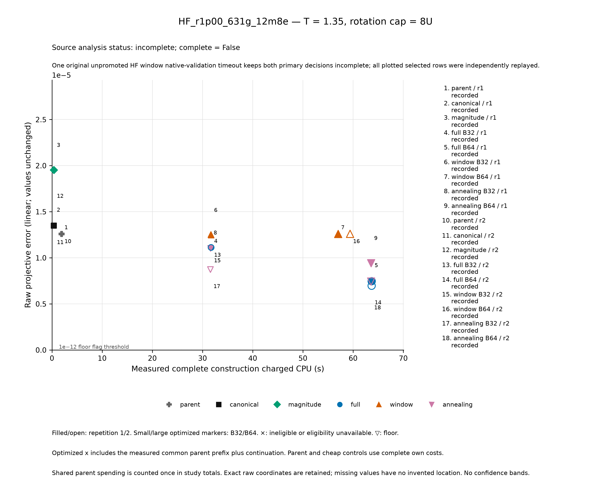
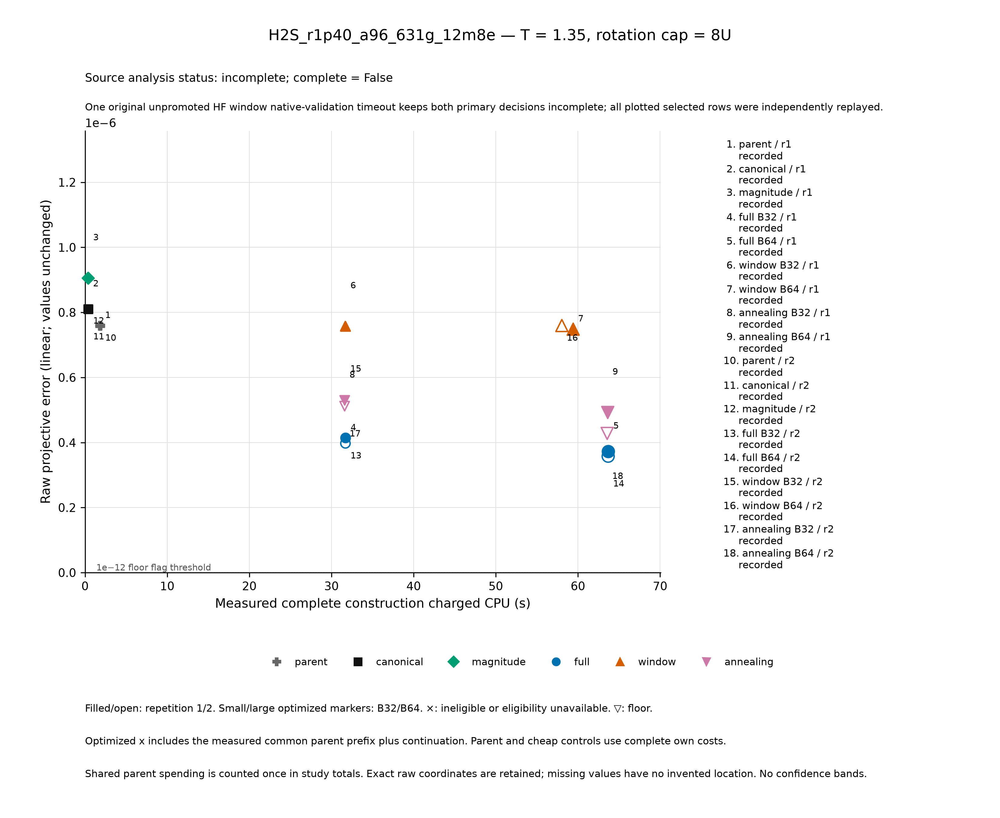

# Two additional molecular families: measured quality versus complete construction cost

**Archive numerical replay and CSV readback passed. Both frozen primary decisions remain INCOMPLETE.**

At the declared B64, T = 1.35, 8U condition, the retained native Full insertion implementation has lower raw projective errors than Window and full-order simulated annealing (SA) in each of the four case/repetition pairs. These are descriptive observations, not a formal winner: the frozen global gate remains incomplete because one unpromoted HF window proposal exhausted its original native-check allowance. All selected orders have verified training scores and complete physical/independent rows; the original missing native check remains censored.

The cost tradeoff is substantial in these small active models. At this condition, separately constructed canonical and magnitude orders cost 0.361–0.391 charged CPU seconds. The optimized comparisons cost 31.582–31.712 seconds at B32 and 57.012–63.702 at B64, including their measured parent prefix. Across the entire declared holdout grid, each optimized arm/budget has lower raw error than both cheap controls in all 32 of its matched comparisons, beyond the 1e−12 ambiguity band (192 descriptive control comparisons in total). These controls remain secondary; neither frozen primary verdict is changed. Full does not dominate every comparison: at B32/T1.35/8U, SA has lower errors in both HF repetitions, whereas Full has lower errors in both H2S repetitions. More construction CPU does not establish a universal ordering or monotone physical improvement.

## Complete observed quality/cost matrix at T1.35/8U

Each table contains nine arm/budget identities and two repetitions: **36 constructor observations in total**. E is raw normalized projective error; smaller is better. Each CPU cell is **own / comparison CPU seconds**. For optimized arms, own is continuation cost and comparison includes the shared measured parent. For parent and cheap context, both entries show their own complete cost. The aggregate analysis assigns zero comparison cost to the standalone parent row to avoid double counting; it does not mean the parent was free. Values here are rounded for display; exact values, walls, statuses, scores, work counters and hashes belong in the [full constructor](evidence/main_2026-10-30/tables/constructors.csv) and [physical](evidence/main_2026-10-30/tables/physical.csv) CSVs.

All 36 constructors are eligible and all 144 physical rows are complete and above the declared numerical floor. Case-level primary eligibility is a separate gate, explained below. B0 labels a control identity; it is not a zero-cost allowance.

| HF arm | B | Rep 1 CPU own / comparison | Rep 1 E | Rep 2 CPU own / comparison | Rep 2 E |
|---|---:|---:|---:|---:|---:|
| Parent | 0 | 1.891 / 1.891 | 1.26008331e-5 | 1.901 / 1.901 | 1.26008331e-5 |
| Canonical | 0 | 0.361 / 0.361 | 1.35003097e-5 | 0.381 / 0.381 | 1.35003097e-5 |
| Magnitude | 0 | 0.371 / 0.371 | 1.95255635e-5 | 0.371 / 0.371 | 1.95255635e-5 |
| Full | 32 | 29.811 / 31.702 | 1.11254050e-5 | 29.801 / 31.702 | 1.11268108e-5 |
| Full | 64 | 61.791 / 63.682 | 7.48204633e-6 | 61.801 / 63.702 | 6.97084511e-6 |
| Window | 32 | 29.801 / 31.692 | 1.24709310e-5 | 29.781 / 31.682 | 1.25284790e-5 |
| Window | 64 | 55.121 / 57.012 | 1.26008331e-5 | 57.501 / 59.402 | 1.26008331e-5 |
| SA | 32 | 29.711 / 31.602 | 1.10212079e-5 | 29.681 / 31.582 | 8.72740833e-6 |
| SA | 64 | 61.691 / 63.582 | 9.43014991e-6 | 61.691 / 63.592 | 7.42206142e-6 |

| H2S arm | B | Rep 1 CPU own / comparison | Rep 1 E | Rep 2 CPU own / comparison | Rep 2 E |
|---|---:|---:|---:|---:|---:|
| Parent | 0 | 1.841 / 1.841 | 7.59567420e-7 | 1.851 / 1.851 | 7.59567420e-7 |
| Canonical | 0 | 0.371 / 0.371 | 8.10068071e-7 | 0.391 / 0.391 | 8.10068071e-7 |
| Magnitude | 0 | 0.381 / 0.381 | 9.05341338e-7 | 0.381 / 0.381 | 9.05341338e-7 |
| Full | 32 | 29.871 / 31.712 | 4.14084358e-7 | 29.851 / 31.702 | 3.97376352e-7 |
| Full | 64 | 61.851 / 63.692 | 3.72894868e-7 | 61.831 / 63.682 | 3.57843762e-7 |
| Window | 32 | 29.851 / 31.692 | 7.57625216e-7 | 29.831 / 31.682 | 7.57625216e-7 |
| Window | 64 | 57.561 / 59.402 | 7.48969791e-7 | 56.191 / 58.042 | 7.59567420e-7 |
| SA | 32 | 29.741 / 31.582 | 5.29624619e-7 | 29.751 / 31.602 | 5.11660267e-7 |
| SA | 64 | 61.751 / 63.592 | 4.92585592e-7 | 61.711 / 63.562 | 4.27837949e-7 |

At B32 the exact retained SA−Full differences are −1.0419708083771409e−7 and −2.399402470142549e−6 for HF, versus +1.1554026042206538e−7 and +1.1428391498054604e−7 for H2S. Window B64 also does not uniformly improve its own B32 physical error. These observations prevent extending the B64 descriptive signs into a global algorithm ranking.

## Two frozen primary questions: source verdicts retained

The primary condition is **B64/T1.35/8U**. Each difference is candidate E minus Full E within the same case/repetition, so positive favors Full descriptively. The numbers below are the source analysis's paired values and case medians; no new statistic or decision is fitted here.

**Window − Full; frozen global decision: INCOMPLETE.**

| Case | Rep 1 raw difference | Rep 2 raw difference | Source median of the two differences | Source pair eligibility (rep 1 / rep 2) | Frozen global gate |
|---|---:|---:|---:|---|---|
| HF | 5.118786761421456e−6 | 5.629987974243339e−6 | 5.374387367832397e−6 | false / false | INCOMPLETE |
| H2S | 3.76074923317087e−7 | 4.0172365864026893e−7 | 3.88899290978678e−7 | true / true | INCOMPLETE |

**SA − Full; frozen global decision: INCOMPLETE.**

| Case | Rep 1 raw difference | Rep 2 raw difference | Source median of the two differences | Source pair eligibility (rep 1 / rep 2) | Frozen global gate |
|---|---:|---:|---:|---|---|
| HF | 1.9481035873696516e−6 | 4.512163078662843e−7 | 1.199659947617968e−6 | false / false | INCOMPLETE |
| H2S | 1.1969072417752811e−7 | 6.999418698779076e−8 | 9.484245558265944e−8 | true / true | INCOMPLETE |

H2S's eligible source pair outcomes are `full_advantage`; HF's source pair outcomes are `incomplete`. Neither per-case signs nor H2S's pair labels replace either global decision. The frozen advantage rule requires both case medians beyond ±1e−12, no resolved opposite repetition and every cost/objective/physical/independent gate. Missing or ineligible evidence yields `incomplete`; otherwise unresolved signs yield the declared mixed/unresolved outcome. The ambiguity threshold and two separate questions remain unchanged.

There are four primary pairs per question, eight together, and two case medians per question. The full secondary grid has 64 named pairs, 32 per question. Two paired timing/seed repetitions are not independent molecular samples and support no confidence interval here. No ratios, confidence intervals, replacement winner labels or difference-of-median statistic are introduced. Under the established ratio policy, a ratio is suppressed if **either** physical error is ≤1e−12; errors are not clipped to construct a ratio.

## What is complete, and what remains scientifically incomplete

The retained inventory is 4 parents + 24 optimized + 8 cheap = **36 selected order records**. Four held-out physical conditions per record, T ∈ {0.65, 1.35} and cap/U ∈ {8, 24}, give **144 physical rows, 144 independent row checks and 144 selected-objective row joins**. There are 72 rows per case, 36 per case/repetition. Training scores repeated over physical conditions are joins, not 144 separately trained orders. Independent propagation covers **104 distinct unfused full-register circuits, 52 per case**, and independently reconstructs **four case/time references**. Deduplication preserves all logical rows and costs.

Every selected row's training score agrees with independent cubic replay within the frozen absolute 1e−24 plus relative 1e−8 tolerance. The 14 persisted raw proposed-best values also agree with independent replay: seven per case, including the unpromoted witness. With exact order deduplication there are 27 score checks, 14 for HF and 13 for H2S. Thirteen raw witnesses have verified original native comparisons. The fourteenth, **HF rep2.window.B64.raw1**, retains `selected=false`, `status=native_refusal_censored`, and its original native refusal: `SearchDeadline`, “whole-call window allowance exhausted.” It has no original native score to backfill. Its independent proposed-value comparison passes; that does not create the missing original check.

There are no physical floor flags among the 144 rows, no objective floor censorings or mismatches, and no per-row issues. The source metadata nevertheless remains HF `complete=false, raw_claims_verified=false`, H2S `complete=true, raw_claims_verified=true`; global `status=incomplete, complete=false`. Its sole issue is `scientific_receipts` / `ValueError` / `Scientific post-teardown FINAL/PLAN/receipt chain`. The HF objective job's exit 2/`partial_or_censored` receipt is retained. This is the strict frozen gate's treatment of the original native censor, not permission to discard that witness.

The original pipeline stopped at this gate. A later dispatch performed only previously unattempted physical, independent, analysis and presentation phases within the original phase allowances. There was no original constructor or objective retry, native-score backfill, proposal promotion or decision-rule change. Search evaluation/proposal counters describe work; objective replay covers selected orders and **persisted raw proposed-best witnesses**, not every transient rejected proposal.

The independent objective reference uses the archived sparse degree-three ResponseCore recurrence with compensated binary64 diagonal transport. The native product's exact-rational diagonal-gap transport is a separately recorded numerical scope. The declared tolerance, actual input/order bytes and independent semantic joins bind their agreement; this is not a claim that the two implementations are bitwise identical on these families.

## Systems, scope and prior use

| Frozen case | Geometry | Hamiltonian model | Frozen / active spatial indices (zero based) | Original words U / units M |
|---|---|---|---|---:|
| HF_r1p00_631g_12m8e | F–H = 1.00 Å | Neutral singlet, 6-31G, CAS(8e,6o), 12 modes | `[0]` / `[1,…,6]` | 630 / 161 |
| H2S_r1p40_a96_631g_12m8e | S–H = 1.40 Å, H–S–H = 96° | Same basis/charge/spin and CAS dimensions | `[0,…,4]` / `[5,…,10]` | 550 / 157 |

These are fixed geometries, not equilibrium/optimized-geometry claims. Four occupied and two lowest virtual canonical orbitals retain eight valence electrons after deep-core freezing. Full-basis AO counts are 11/17 and total electron counts 10/18. Both circuit calculations use all **4096** amplitudes. Each exact-H reference uses the complete **495-state fixed-N sector**, with checked coupling to its complement, not the smaller 225-state fixed-spin block. The initial HF state has the low eight occupation bits set. The finite active Hamiltonian, HF state and two times limit every physical conclusion.

Conversion retains exact rational metadata derived from binary64 coefficients, with exact adjoint averaging/CAR/Jordan–Wigner consolidation, a 1e−12 whole-fermionic-parent cutoff and no additional Pauli cutoff. Internally commuting units exactly conserve particle number and interleaved alpha number. “Exact reference” concerns this frozen finite active model under recorded numerical tolerances, not unrestricted molecular physics.

Inputs were fixed before new-family training or physical outcomes. A scoped current-tree/retained-archive audit located no HF molecular use; this is not a universal never-used claim. H2S appeared in older first-order J_D development and Strang propagation of retained orders, but no current cubic-development use was located. H2S is held out only in that narrower sense; absolute historical geometry novelty is unknown. External/unretained history and excluded raw/document formats remain outside the audit. Neither weak signal nor unfavorable errors permit replacing a family.

## Same training objective, different search domains and implementations

All selected scores use T = 1 and original rotation budget 30U. J is the squared norm of the Hartree–Fock-orthogonally-projected cubic symmetric-step response after diagonal-reference transport, divided by affordable steps to the fourth power. It is a surrogate, not a finite-time physical-error bound. Scalar centering is response-only; original implemented words determine costs. Physical evaluation uses second-order symmetric product formulas and normalized projective error

`E = 1 − |<reference|circuit>| / (||reference|| ||circuit||)`,

computed by the stable residual implementation. Raw overlap deficit, infidelity, norms, leakage, floors and state hashes remain retained. For M > 1, endpoint word counts l_first/l_last and cap qU give exact adjacent-boundary fusion:

`r_q = floor((qU − l_first)/(2U − l_first − l_last))`,

`rotations = r_q(2U − l_first − l_last) + l_first`.

Only adjacent identical unit labels fuse. Endpoint changes therefore change normalization. Counts are ideal Pauli rotations, not hardware runtime.

The common parent is bounded native insertion (8 CPU/40 wall seconds, 3000 evaluations, five moves, retained magnitude/reverse/canonical starts). Full is the retained native Python unrestricted full-order insertion continuation. Window is the existing Julia width-eight interior refinement, preserving surrounding order and global endpoints; its caps include 32 windows, 100 sweeps and 200,000 atoms. Full and SA share four starts: the parent plus deterministic 1/2/4 interior insertions. Starting with fixed endpoints does not restrict their subsequent complete permutation domain. Canonical uses original labels; magnitude sorts descending exact rational coefficient magnitude, breaking ties by original label. Cheap controls perform no insertion moves.

SA uses unrestricted insertion Metropolis and four separately seeded Xoshiro chains. Downhill/equal normalized changes are accepted; uphill probability is `exp(−delta/theta)`, with `normalizer = max(parent_J,1e−30)` and `delta = J_proposed/normalizer − J_current/normalizer` (the implementation’s binary64 evaluation order). CPU-balanced interleaving chooses the least-spent chain, ties by original index. After scoring starts and initializing chains, each share is one quarter of remaining child CPU; temperature cools geometrically with chain CPU/share. Interrupted work/checkpoint cost is charged, and an exhausted chain is not retried. Finite search has no optimality or approximation-ratio guarantee.

Temperatures **0.04155802571112692 → 0.002013694406127226** were frozen on OLD CO/CH4 only: 32 predeclared insertion probes per case, 64 total, 38 positive normalized native deltas; pooled positive median d and endpoints `−d/log(0.8)`, `−d/log(0.01)`. No new-family physical result fitted a temperature, seed, start, cap or stopping rule. The complete three-attempt calibration evidence remains separately retained.

The comparison is end to end: Python Full versus Julia Window/SA combines algorithm, domain restrictions, runtime/JIT and backend implementation. It does not isolate search strategy causally. Li's annealing work optimizes a fixed-observable observation-error bound, a different objective from this HF cubic J; it motivates this heuristic comparison without guaranteeing its result. See Langyu Li, *Principal Trotter observation error with truncated commutators*, Phys. Rev. A **110**, 062614 (2024), [primary DOI](https://doi.org/10.1103/PhysRevA.110.062614).

## Complete cost boundary and old-only controls

Each B32/B64 optimized call includes its measured common parent prefix and continuation. The parent is executed once per case/repetition, attributed to six optimized arm/budget comparisons, and counted once in actual workflow spending. Cheap controls have fresh own invocations, 8 CPU/40 wall ceilings and no parent prefix. Startup, imports, loading, JIT, setup, checks, serialization, teardown and interrupted/failed work are charged. Physical-grid expansion does not multiply constructor cost; no warm daemon or free compilation is used. One invocation is allowed per frozen main constructor identity.

| Cost scope | Raw CPU seconds | Charged CPU seconds | Owned wall seconds |
|---|---:|---:|---:|
| Actual constructor services, parent counted once | 1088.070 | 1088.466 | 4654.883628 |
| Comparison attribution, repeated parent prefixes | 1125.270 | 1125.886 | 4836.222214 |

The second row is not additional spending. The incremental main numerical ledger before final curation records **58 unique services, 1361.888 charged CPU seconds and 5778.800949 owned wall seconds**, including two preparation attempts and all nonzero payload exits. This includes the archived replay’s **113.177 CPU / 463.235274 wall seconds**; do not add that replay again. Final curation adds 0.401 charged CPU / 3.042876 wall seconds, giving **59 main services, 1362.289 charged CPU seconds / 5781.843825 owned wall seconds**. The [final resource summary](evidence/main_2026-10-30/accounting/RESOURCE_SUMMARY.json) binds both boundaries and the actual curation receipt. Old plus main numerical service spending is 3698.537 CPU seconds; calibration is already included. The later figure consumer cost 2.741 CPU / 12.0634 wall seconds within the analysis pool, and must not be counted again when that pool is reconciled. Wall sums are owned-job elapsed time, not calendar duration. Missing cost remains unknown, never zero.

The numerical profile uses one thread, quarter-core CPU quota, 448/512 MiB memory bounds and no swap. Annealing's heap256 hint keeps the same constructor OS ceiling. Old-only verification tasks had separately declared larger RAM allowances; constructor limits were not raised. The exact scalar-cache compression, CPU-balanced scheduling and cold-start implementation were settled on old data before main errors; the frozen [protocol](PROTOCOL.json) records their complete settings. These revisions preserve numerical arithmetic and charge owned Julia startup/JIT.

Three failed old pilots, startup/profile/harness failures, the failed first scalar bridge and interrupted regressions retain their original source mappings and costs in the [old evidence bundle](evidence/preflight_2026-10-30/README.md). They are development evidence, not additional prospective observations. No failed attempt is relabelled as a pass.

Accepted old LiH a4 (producer 79eff7fe) completed nine orders/36 logical physical, independent and selected-objective rows, three raw claims, 24 distinct circuits and two references. Its complete annealing comparison costs were 30.952/63.232 CPU seconds including the parent. Relocated numerical circuit/objective replay and metadata joins completed from its extracted archive, with the failed first metadata comparison retained. These establish old-case feasibility, cost admission and replay, not prospective family accuracy. See the existing [preflight evidence](evidence/preflight_2026-10-30/README.md).

The committed old ledger deduplicates 89 closed owned services, retaining **2336.248 guarded CPU seconds / 11417.502078 wall seconds**, within amended old ceilings 3200/20000. This already includes the three calibration attempts' **661.83 CPU seconds**; do not add calibration again. The separate conservative four-second control-plane allowance and unknown historical reservations remain stated. Exact failed/header/interrupted test-source bytes were not contemporaneously frozen; retained failure logs do not certify a pass. No old-development performance is pooled as a prospective molecular observation.

## Figures, retained tables and reproducibility

Two later presentation PNGs were rendered and visually inspected: zero-based linear axes, headroom and visible marker bounds preserve all 18 observations per case. Their raw JSON equals the original plot data and their raw CSV is byte-identical; original plots with clipped marker bounds remain retained. The later consumer is separately identified and explicitly captions global incompleteness. Its presentation correction changes no outcome, cost, censor or decision.

The evidence bundle retains the complete attempted matrix and every known failure/status:

- [Constructor table: 36 rows](evidence/main_2026-10-30/tables/constructors.csv), [physical/independent/selected-objective join: 144 rows](evidence/main_2026-10-30/tables/physical.csv), [full named grid: 64 pairs](evidence/main_2026-10-30/tables/named_pairs.csv).
- [All 14 persisted raw claims and the original native censor](evidence/main_2026-10-30/tables/persisted_raw_claims.csv), [192 descriptive cheap-control pairs](evidence/main_2026-10-30/tables/cheap_context.csv), [exact source primary decisions](evidence/main_2026-10-30/tables/PRIMARY_QUESTIONS.json). The cheap denominator is 96 optimized physical rows × two cheap controls. The exports retain raw errors and floor flags, refusal/status fields, raw/charged/attributed costs and missing counters without guessing.
- [HF quality/cost figure](evidence/main_2026-10-30/figures/HF_r1p00_631g_12m8e.primary_quality_cost.png), [H2S quality/cost figure](evidence/main_2026-10-30/figures/H2S_r1p40_a96_631g_12m8e.primary_quality_cost.png), [presentation provenance and visual gate](evidence/main_2026-10-30/figures/VISUAL_VERIFIED.json).
- [Original analysis](evidence/main_2026-10-30/data/ANALYSIS.json), [source/input freeze](evidence/main_2026-10-30/data/INPUT_PROTOCOL_FROZEN.json), [archive inventory and relocated replay](evidence/main_2026-10-30/replay/REPLAY_FINAL.json). The seven-stage archive/extraction/numerical replay reproduced all 144 selected rows, 104 distinct circuits, four references, 27 objective checks and 14 proposed-value comparisons, including the exact original native censor. Original and extracted seals remained unchanged; all original analysis fields/digests matched, with only the separately authenticated post-analysis figure PLAN digest added.

Table export and an independent CSV readback checked all 36 constructor rows, 144 physical rows, 64 named pairs, 14 persisted raw claims and 192 descriptive cheap-control pairs against the sealed original records. The exact primary objects and absent original native value were preserved. These are delivery/replay checks; source `complete=false` and both `incomplete` decisions remain unchanged.

| Provenance | Exact identity |
|---|---|
| Numerical producer commit | `aea354e287f2277d8b11cc51695a6d49f7e84537` |
| Input/protocol/source freeze SHA-256 | `f3ed635ac7831edcb3feb51d96e6116c2c95f7ad9e2b169b006ca862006776e3` |
| Original analysis SHA-256 | `f3ed8ebc084507bab3b6a159c97e287f0dcbbbb094533439da3b98a8c5c0e6fa` |
| Replayed archive SHA-256 | `4d1639d4c8c9ae29226d0b7e8bf1112897ad5c439327966baff8512f67da1892` |
| Original/extracted inventory SHA-256 | `00bf1155a36dba6517edfab25755cb18d27a63c0f99d765dcf160934b9fb7bc9` |

The archive contains the authoritative self-contained producer graph. Loose evidence files are selected convenience copies; historical absolute paths identify their producers and are not commands to rerun blindly. See the bundle’s reproduction instructions for the archived CLI entrypoints and separately identified later consumers. Review, publication, merge and exact-commit CI evidence belong to the delivery record for the relevant revision.
