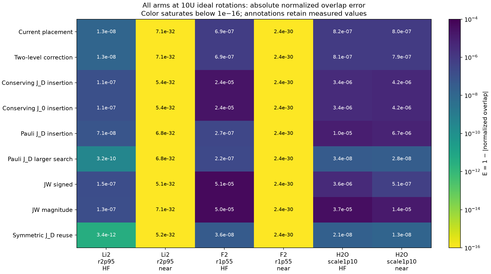
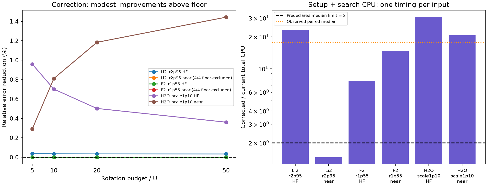

# Prospective ordering decision: three new molecular inputs

The fixed two-level reference correction **fails** the predeclared development gate. At the primary rotation budget B=10U it gives 3 wins, 3 ties and 0 losses against the current diagonal-placement construction. The median paired error ratio is 0.99632; its total construction CPU ratio is 17.6199. These are six related determinant inputs from three molecular families, not a statistical validation of general usefulness.

| Predeclared requirement | Observed | Pass |
| --- | --- | --- |
| At least 4/6 wins at 10U | 3/6 | False |
| No strict loss exceeds 2× | No strict losses (guard defaults to 1) | True |
| Median paired total construction CPU ratio ≤2× | 17.6199× | False |

This experiment advances the search for an ordering by testing a fixed, inexpensive-to-describe reference correction against optimized controls on fresh physical inputs. The correction was fixed before generating these tensors; its outcome is retained without retuning or replacing it. The result does not identify an optimal ordering or isolate conservation as the cause of accuracy gains.

The correction's primary median ratio uses 4 above-floor baselines; Li2_r2p95 near, F2_r1p55 near are floor-limited and supply little discrimination. Its roughly 0.37% median error reduction is small compared with the observed construction overhead. The development decision is to retain current placement and not adopt this correction on this evidence. At 10U, current placement beats conserving J_D insertion on 4 inputs with 2 ties, but loses to the larger-search Pauli and symmetric controls on those same four informative inputs. Current/control median error ratios are 26.35 and 49.07 respectively. J_D and J_0 insertion produce the same physical errors here; this panel does not isolate a weighting advantage. These are scoped comparisons, with unequal classical work for the larger Pauli search and a different formula for the symmetric control.

## What is being ordered

The order is over complete fermionic flip-mask units after exact CAR/Jordan–Wigner consolidation, with each retained diagonal Pauli word movable separately. Complete off-diagonal units preserve particle number and spin projection. Both placement candidates fix the off-unit order by decreasing coefficient l1 norm, then choose diagonal positions with one sweep. This is an ordering of Hamiltonian evolution terms; the orbital basis and spin-orbital numbering stay fixed within every comparison. The unchanged exact one-pass diagonal step uses a newly declared coefficient-l1 initialization here, rather than the inherited optimized off-order used in the earlier 77/84 study.

The current score transports its leading commutator through diagonal D. The correction uses A=D+h(|u><v|+|v><u|), choosing the strongest retained coupling from the input determinant with fixed ties. It uses two commutator columns and a 2×2 eigensystem, without diagonalizing H for search. The reference affects scoring only. Coherent response amplitudes are added before squaring; corrected scores use binary64 complex arithmetic and do not inherit the current score's exact supplied-weight comparison guarantee.

## Panel, physical costs and controls

Neutral singlet RHF/STO-6G: Li2 at 2.95 Å, 2 active electrons/6 spin orbitals; F2 at 1.55 Å, 6/8; H2O at 1.10× the declared geometry, 4/8. Freeze lowest occupied orbitals and use the next active window. Inputs are HF and the nearest same-(Nα,Nβ) determinant (Hamming distance, then occupation-integer tie). T=1 inverse Hartree, hbar=1. Li2 and F2 also change basis/active space relative to earlier fixtures, so changes in ranking cannot be assigned to geometry alone. The full geometries, orbital metadata, target cutoff/scalar conventions and selection rules are in the frozen protocol and evidence.

U is the retained nonidentity Pauli-word count: Li2=33, F2=60, H2O=104. Budgets are 5U, 10U, 20U and 50U ideal Pauli rotations. First-order arms use floor(B/U) steps. Symmetric execution uses the largest affordable step count after exact identical-boundary fusion. It reuses the conserving J_D first-order order; it is not optimized for second order. Ideal rotations do not establish two-qubit gates, depth or hardware performance.

Conserving J_D/J_0 insertion and individual-Pauli J_D insertion use two fixed starts and the same examined-position cap E=(k+1)(m+1) as placement, counting every position, with at most ten accepted moves per start. Equal positions do not match arithmetic or CPU. The larger Pauli control has an explicitly unequal cap 20P(P−1) and the same move limit. Fixed JW signed and magnitude orders are included. All nine arms implement exactly the same retained target, and every propagation retains the entire 2^n space, including leakage.

## Absolute errors at the primary budget

E=1−|normalized overlap|, computed by a stable residual formula. Smaller is better. The table shows all nine arms and all six inputs at 10U; [all 216 rows](all_rows.csv) retain every budget, absolute error, leakage, steps, rotations, timing and state hash.

| Method | Li2_r2p95 HF | Li2_r2p95 near | F2_r1p55 HF | F2_r1p55 near | H2O_scale1p10 HF | H2O_scale1p10 near |
| --- | --- | --- | --- | --- | --- | --- |
| Current placement | 1.26534e-08 | 7.06413e-32 | 6.85101e-07 | 2.35656e-30 | 8.16929e-07 | 7.95420e-07 |
| Two-level correction | 1.26490e-08 | 7.06413e-32 | 6.85101e-07 | 2.35656e-30 | 8.11197e-07 | 7.88970e-07 |
| Conserving J_D insertion | 1.13095e-07 | 5.41976e-32 | 2.41517e-05 | 2.37378e-30 | 3.35305e-06 | 4.24469e-06 |
| Conserving J_0 insertion | 1.13095e-07 | 5.41976e-32 | 2.41517e-05 | 2.37378e-30 | 3.35305e-06 | 4.24469e-06 |
| Pauli J_D insertion | 7.07308e-08 | 6.79738e-32 | 2.65752e-07 | 2.35656e-30 | 9.97085e-06 | 6.72494e-06 |
| Pauli J_D larger search | 3.17512e-10 | 6.79738e-32 | 2.23389e-07 | 2.35656e-30 | 3.41127e-08 | 2.76673e-08 |
| JW signed | 1.45191e-07 | 5.12255e-32 | 5.05530e-05 | 2.41051e-30 | 3.60886e-06 | 5.07655e-07 |
| JW magnitude | 1.25731e-07 | 7.06413e-32 | 5.01625e-05 | 2.35656e-30 | 3.70308e-05 | 1.38629e-05 |
| Symmetric J_D reuse | 3.41586e-12 | 5.20204e-32 | 3.63991e-08 | 2.41390e-30 | 2.13123e-08 | 1.33004e-08 |

## Correction across budgets and construction costs

Wins/losses use absolute error differences beyond ±1e−12. Descriptive error ratios omit denominators ≤1e−12; the protective loss condition retains strict losses using corrected/max(current,1e−12). Both frozen implementations agree on all decision predicates and contrasts. The graph identifies excluded ratios in its legend rather than dividing by a numerical floor.

| Input | State | Current CPU s | Correction CPU s | Ratio |
| --- | --- | --- | --- | --- |
| F2_r1p55 | HF | 0.00438684 | 0.0336069 | 7.66084 |
| F2_r1p55 | near | 0.000926614 | 0.0135431 | 14.6157 |
| H2O_scale1p10 | HF | 0.0026188 | 0.0798928 | 30.5074 |
| H2O_scale1p10 | near | 0.0045502 | 0.0938441 | 20.6242 |
| Li2_r2p95 | HF | 0.00055935 | 0.0129642 | 23.1772 |
| Li2_r2p95 | near | 0.0030366 | 0.00445567 | 1.46732 |

CPU costs include method-specific reference/features/setup plus search; they exclude shared integral generation and physical-error validation. [All construction costs](construction_costs.csv) separate setup, search, examined positions and order reuse; [all contrasts](contrasts.csv) compare both placement candidates with every other arm at every budget. The symmetric arm reuses the J_D construction, so its cost is inherited rather than a second independent search. One timing per input under a quarter-core shared-machine quota is a development measurement, not a controlled speedup benchmark.

## Full contrast inventory

W/T/L refers to the numerator method's lower/tied/higher error. A ratio below one favors that method. Every comparator is retained, including the larger-search Pauli and symmetric controls.

| Numerator / denominator | B/U | W/T/L | Median error ratio | Excluded floors |
| --- | --- | --- | --- | --- |
| current_over_pair_reference | 5 | 0/3/3 | 1.0016 | 2 |
| current_over_optimized_JD | 5 | 4/2/0 | 0.14942 | 2 |
| current_over_optimized_J0 | 5 | 4/2/0 | 0.14942 | 2 |
| current_over_pauli_JD | 5 | 3/2/1 | 0.14863 | 2 |
| current_over_pauli_JD_large | 5 | 0/2/4 | 23.363 | 2 |
| current_over_jw_signed | 5 | 3/2/1 | 0.15748 | 2 |
| current_over_jw_magnitude | 5 | 4/2/0 | 0.039901 | 2 |
| current_over_symmetric_JD | 5 | 0/2/4 | 4.986 | 2 |
| pair_reference_over_current | 5 | 3/3/0 | 0.99836 | 2 |
| pair_reference_over_optimized_JD | 5 | 4/2/0 | 0.14912 | 2 |
| pair_reference_over_optimized_J0 | 5 | 4/2/0 | 0.14912 | 2 |
| pair_reference_over_pauli_JD | 5 | 3/2/1 | 0.14842 | 2 |
| pair_reference_over_pauli_JD_large | 5 | 0/2/4 | 23.238 | 2 |
| pair_reference_over_jw_signed | 5 | 3/2/1 | 0.15638 | 2 |
| pair_reference_over_jw_magnitude | 5 | 4/2/0 | 0.03971 | 2 |
| pair_reference_over_symmetric_JD | 5 | 0/2/4 | 4.9584 | 2 |
| current_over_pair_reference | 10 | 0/3/3 | 1.0037 | 2 |
| current_over_optimized_JD | 10 | 4/2/0 | 0.14964 | 2 |
| current_over_optimized_J0 | 10 | 4/2/0 | 0.14964 | 2 |
| current_over_pauli_JD | 10 | 3/2/1 | 0.14859 | 2 |
| current_over_pauli_JD_large | 10 | 0/2/4 | 26.349 | 2 |
| current_over_jw_signed | 10 | 3/2/1 | 0.15676 | 2 |
| current_over_jw_magnitude | 10 | 4/2/0 | 0.039719 | 2 |
| current_over_symmetric_JD | 10 | 0/2/4 | 49.068 | 2 |
| pair_reference_over_current | 10 | 3/3/0 | 0.99632 | 2 |
| pair_reference_over_optimized_JD | 10 | 4/2/0 | 0.14886 | 2 |
| pair_reference_over_optimized_J0 | 10 | 4/2/0 | 0.14886 | 2 |
| pair_reference_over_pauli_JD | 10 | 3/2/1 | 0.14808 | 2 |
| pair_reference_over_pauli_JD_large | 10 | 0/2/4 | 26.148 | 2 |
| pair_reference_over_jw_signed | 10 | 3/2/1 | 0.15595 | 2 |
| pair_reference_over_jw_magnitude | 10 | 4/2/0 | 0.039409 | 2 |
| pair_reference_over_symmetric_JD | 10 | 0/2/4 | 48.691 | 2 |
| current_over_pair_reference | 20 | 0/3/3 | 1.0027 | 2 |
| current_over_optimized_JD | 20 | 4/2/0 | 0.14994 | 2 |
| current_over_optimized_J0 | 20 | 4/2/0 | 0.14994 | 2 |
| current_over_pauli_JD | 20 | 3/2/1 | 0.1487 | 2 |
| current_over_pauli_JD_large | 20 | 0/2/4 | 27.578 | 2 |
| current_over_jw_signed | 20 | 3/2/1 | 0.15664 | 2 |
| current_over_jw_magnitude | 20 | 4/2/0 | 0.039727 | 2 |
| current_over_symmetric_JD | 20 | 0/2/4 | 153.44 | 3 |
| pair_reference_over_current | 20 | 3/3/0 | 0.99732 | 2 |
| pair_reference_over_optimized_JD | 20 | 4/2/0 | 0.1488 | 2 |
| pair_reference_over_optimized_J0 | 20 | 4/2/0 | 0.1488 | 2 |
| pair_reference_over_pauli_JD | 20 | 3/2/1 | 0.14797 | 2 |
| pair_reference_over_pauli_JD_large | 20 | 0/2/4 | 27.343 | 2 |
| pair_reference_over_jw_signed | 20 | 3/2/1 | 0.15606 | 2 |
| pair_reference_over_jw_magnitude | 20 | 4/2/0 | 0.039332 | 2 |
| pair_reference_over_symmetric_JD | 20 | 0/2/4 | 152.67 | 3 |
| current_over_pair_reference | 50 | 0/4/2 | 1.002 | 2 |
| current_over_optimized_JD | 50 | 4/2/0 | 0.15017 | 2 |
| current_over_optimized_J0 | 50 | 4/2/0 | 0.15017 | 2 |
| current_over_pauli_JD | 50 | 3/2/1 | 0.14881 | 2 |
| current_over_pauli_JD_large | 50 | 0/2/4 | 27.97 | 2 |
| current_over_jw_signed | 50 | 3/2/1 | 0.15665 | 2 |
| current_over_jw_magnitude | 50 | 4/2/0 | 0.039763 | 2 |
| current_over_symmetric_JD | 50 | 0/2/4 | 959.84 | 3 |
| pair_reference_over_current | 50 | 2/4/0 | 0.99803 | 2 |
| pair_reference_over_optimized_JD | 50 | 4/2/0 | 0.1488 | 2 |
| pair_reference_over_optimized_J0 | 50 | 4/2/0 | 0.1488 | 2 |
| pair_reference_over_pauli_JD | 50 | 3/2/1 | 0.14792 | 2 |
| pair_reference_over_pauli_JD_large | 50 | 0/2/4 | 27.719 | 2 |
| pair_reference_over_jw_signed | 50 | 3/2/1 | 0.15623 | 2 |
| pair_reference_over_jw_magnitude | 50 | 4/2/0 | 0.039309 | 2 |
| pair_reference_over_symmetric_JD | 50 | 0/2/4 | 956.37 | 3 |

## Verification and scope

All 216 circuits were independently replayed with literal NumPy Pauli rotations; symmetric circuits were replayed without boundary fusion and checked against independently counted fused budgets. Independent sparse exponential actions check exact references. Raw saved tensors are bridged through literal CAR to the retained target under the bounded declared Hermitian-adjustment/parent-cutoff allowance; orbital orthogonality, HF energy, Kronecker/bit-indexing, complete-unit conservation, partner/state choice, current exact search ledger, response scores, schedules and frozen source hashes are checked separately. The verifier imports neither QHAT nor the search/propagation engine. This complements source review; it is not formal verification of the executable.

Maximum number leakage in conserving arms: 2.31742e-34; maximum spin-projection leakage: 2.31742e-34. Individual-Pauli arms retain their observed leakage in the rows. Source commit before generation: `bcb104e1743a4df89dec03fa36cecb8c342974d3`. Evidence summary status: `passed`; independent replays: 216. [Report provenance](provenance.json) binds the frozen summary, renderer and exported tables.

The original supervisor used a 4 GiB cap and 6 GiB start threshold for generation and construction. Before any physical propagation, a documented operational amendment tightened the remaining jobs to 512 MiB (448 MiB high), retained quarter-core/no-swap settings and the 5 GiB pause threshold, and lowered start/resume to 5.5 GiB. The original waiting propagation launcher was interrupted before launching a service. Scientific source, inputs, schedules and construction timings were unchanged. The retained OPERATIONAL_AMENDMENT.json and supervisor bytes disclose this deviation from the original resource protocol.

The new evidence covers small real determinant inputs at one time, three related molecular families and fixed orbitals. It does not validate correlated/coherent inputs, large spaces, a new encoding, compiled cost, second-order optimization, general timing performance or physical-error optimality. The separate JW/BK formalization is unchanged. See the paper companion for the development decision and slide-derived future work.
